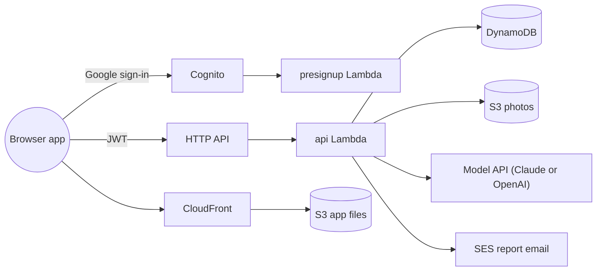

# meters-tracker

A Hebrew chat for a building owner who bills each apartment for the water and electricity it
uses. The owner sends a photo of a meter; the app reads the serial and the counter, proposes the
reading, and saves it once the owner confirms. It keeps each meter's history and each apartment's
billing periods, and after every reading reports the consumption and the charge. Each deployment
runs in its operator's own AWS account and serves the owners the operator admits.

**[Walk through a demo chat](https://dn6u06azerauv.cloudfront.net/demo.html)** — an animated
replay of one owner's story on a phone screen, from linking an apartment's meters to the closing
readings two months later. Its source is `docs/demo/demo.html`, which every deployment publishes
beside the app.

**Contents:** [Overview](#overview) · [Tech stack](#tech-stack) · [Architecture](#architecture) ·
[Getting started](#getting-started) · [Scripts](#scripts) · [Details](#details) ·
[License](#license)

## Overview

- Everything happens in one chat, in Hebrew, in the browser. There are no forms: the app
  proposes, and the owner confirms with a button or corrects it in plain words ("the reading is
  39269"). On wide windows a panel beside the chat lists the day's saved and waiting readings.
- A photo of a water or electricity meter is read for its serial number and its counter. Nothing
  is saved until the owner confirms, and a photo the app cannot read with certainty is never
  guessed at: it asks for a retake or a typed value.
- A meter seen for the first time is linked to its property and apartment, which the chat
  creates by name when they are new. A new meter in an apartment that already has one of the
  same kind replaces it. An electricity display that shows two numbers is asked about once.
- Each apartment bills by periods, two months by default, shared by its water and electricity
  meters. A reading at or near the period's end offers to close it, and the next period opens
  the day after. The owner can also close early, mark the apartment vacant, or set a new start
  date for a new tenant, all in plain words.
- After each reading the reply shows the previous reading, the consumption since then and over
  the period so far, and the charge when prices are on record. Prices are typed in the chat or
  read from a photo of a previous statement. On the first visit of a day, the chat names every
  apartment whose period has ended without closing readings.
- Readings that look wrong are questioned: a second reading on the same day, a value lower than
  the last one (misread, or a reset meter), a jump far above the meter's usual daily use, or a
  photo a few days off a period's closing reading, which can move the close to it.
- Once a period is closed and both its meters are read and priced, the owner gets one email with
  a PDF of the apartment's period: both meters, their costs and the total.
- Sign-in is with a Google account. Only addresses on the operator's allowed list can sign up;
  each gets an account of its own, unless an owner has added it in the chat as a delegate, who
  then works in the owner's account. A delegate's address must be on the list too.
- What is planned next, such as an email reminder of an unclosed period, is in the
  [issues](https://github.com/erancha/meters-tracker/issues).

## Tech stack

- **Backend** — Python 3.13 Lambdas on arm64 behind an API Gateway HTTP API, DynamoDB
  tables, a private S3 bucket for photos
- **Frontend** — a React and TypeScript single-page app built with Vite, served from S3 behind
  CloudFront
- **Auth** — Cognito with Google as the only sign-in; a pre-sign-up Lambda enforces the allowed
  list and asks SES to verify each new address, so report mail can reach it
- **Email** — SES sends the period report, a PDF drawn with fpdf2
- **Model** — Claude (`claude-opus-5-5`) by default, or an OpenAI model, chosen by one deploy
  setting; each provider's own SDK, each answer parsed into a typed schema; each provider's API
  key in SSM Parameter Store
- **Infrastructure** — CloudFormation stacks, one for Cognito and one for the app, deployed
  by shell scripts; tables and photos retained across stack deletes
- **Tests** — pytest with moto and a fake model; ruff for lint and format; Vitest with Testing
  Library for the frontend; GitHub Actions runs both suites

## Architecture

Nothing runs between requests. Each chat turn wakes one Python function, which runs the turn
through a scripted conversation engine: code decides every step and writes every reply, and the
model is asked only to read a photo or to classify a message. The data lives in DynamoDB tables
and the photos in S3, both kept when a stack is deleted.

**[Architecture](docs/architecture.md)** continues from here: the full diagram, each route and
table, how the conversation engine queues confirmations, and how the code is laid out.

## Getting started

You need an AWS account, the AWS CLI, `jq`, Python 3.13 and Node 22.

1. `./scripts/init-env.sh` creates the gitignored settings files in `scripts/lib/` from their
   `.example` files. Fill in `aws-config.sh` and `params.sh`; each setting's comment says what it
   holds and whether it is required.
2. Create the Google OAuth client and put its id and secret in `secrets.sh`
   ([Setting up Google](docs/sign-in.md#setting-up-google)).
3. `./scripts/test.sh` runs the backend checks and creates `.venv` on its first run;
   `cd frontend && npm ci && npm test` runs the frontend's.
4. `./scripts/aws-helper.sh --set-model-key anthropic` stores your Anthropic API key.
5. `./scripts/deploy.sh --frontend` deploys the app and prints its address, where you sign in.

`npm run dev` in `frontend/` serves the app locally on port 8000 against the branch's deployed
stacks. [Development](docs/development.md) has the details.

## Scripts

- `init-env.sh` — creates the gitignored settings files under `scripts/lib/` from their
  `.example` files
- `test.sh` — shell syntax check, lint, format check and the backend test suite
- `deploy.sh` — builds the Lambda package and deploys both stacks; `--frontend` also builds and
  publishes the browser app and the demo page, `--frontend-only` does only that
- `aws-helper.sh` — every AWS operation on the deployed stacks: logs and errors, the model
  spend, SES verification, storing a model key, deleting both stacks while keeping the data

Tools that work on the model or one stack's data (evaluations, a replay, an account reset,
backups) are in [scripts/tools/](scripts/tools/README.md).

## Details

- [Feature overview](docs/features.md) — what a user sees in the browser app, screen by screen
- [Architecture](docs/architecture.md) — what each part is for, the storage and the codebase
- [Sign-in](docs/sign-in.md) — how Google sign-in through Cognito works, the Google console
  setup for a new deployment, and who may sign in
- [Design patterns](docs/design-patterns.md) — the shapes the code repeats and what each is for
- [Domain rules](docs/domain-rules.md) — how readings are checked, how periods open and close,
  and how consumption and charge are computed
- [Development & deployment](docs/development.md) — setup, tests, the scripts and the gotchas
- [Decision records](docs/adr/) — why the app is built this way, one decision per record

## License

Source-available under the [PolyForm Noncommercial License 1.0.0](LICENSE). Reading the source,
forking it and running a private deployment are free for anyone, companies included —
[NOTICE](NOTICE) grants that explicitly for evaluating the project or its author. Building a
commercial product or service on it needs a commercial license: erancha@gmail.com.
