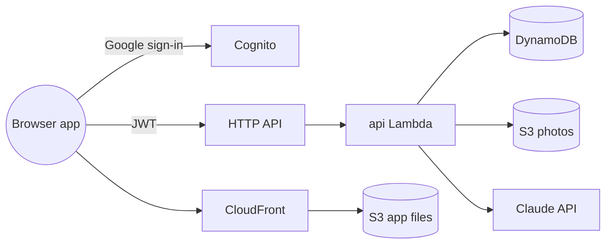

# meters-tracker

A Hebrew chat for a building owner who bills each apartment for the water and electricity it
uses. The owner sends a photo of a meter; the app reads the serial and the counter, proposes the
reading, and saves it once the owner confirms. It keeps each meter's history and each apartment's
billing periods, and after every reading reports the consumption and the charge.

**[Walk through the planned chat](docs/demo/demo.html)** — an animated replay of one owner's
story on a phone screen, from linking an apartment's meters to the closing readings two months
later; it shows the whole planned product, including the parts not built yet. Open the file in a
browser; a deployment also publishes it at `/demo.html` beside the app.

## Overview

- Everything happens in one chat, in Hebrew. There are no forms: the app proposes, and the owner
  confirms with a button or corrects it in plain words ("the reading is 39269").
- A photo of a water or electricity meter is read for its serial number and its counter. Nothing
  is saved until the owner confirms, and a photo the app cannot read with certainty is never
  guessed at: it asks for a retake or a typed value.
- A meter seen for the first time is linked to its property and apartment, which the chat
  creates by name when they are new. A new meter in an apartment that already has one of the
  same kind replaces it.
- An electricity display that shows two numbers is asked about once; the app remembers which
  number counts for that meter.
- Each apartment bills by periods, two months by default, shared by its water and electricity
  meters. A reading at the period's end offers to close it, and the next period opens the day
  after. The owner can also close early, mark the apartment vacant, or set a new start date for
  a new tenant, all in plain words.
- After each reading the reply shows the previous reading, the consumption since then and over
  the period so far, and the charge when prices are on record.
- Readings that look wrong are questioned: a second reading on the same day, a value lower than
  the last one (misread, or a reset meter), or a late photo near a period's closing reading.
- A new account's chat opens with a welcome that says to start with a meter photo. On the first
  visit of a day, the chat names every apartment whose period has ended without closing readings.
- Sign-in is with a Google account. Each address has an account of its own, and an address the
  owner delegates works in that owner's account. The owner adds, lists and removes delegates in
  the chat.
- The chat runs in the browser: sign in with Google, photograph a meter or pick photos, answer a
  card with a button or type a turn. On wide windows a panel shows the day's saved and waiting
  readings.
- Prices are typed in the chat or read from a photo of a previous statement; closing a period
  with no prices on record asks for them.
- Once a period is closed and both its meters are read and priced, the owner gets one email with
  a PDF of the apartment's period: both meters, their costs and the total.
- What is planned next, such as a daily reminder, is in the
  repository's [issues](https://github.com/erancha/meters-tracker/issues).

## Tech stack

- **Backend** — Python 3.13 Lambdas on arm64 behind an API Gateway HTTP API, nine DynamoDB
  tables, a private S3 bucket for photos
- **Model** — Claude (`claude-opus-5-5`) by default, or an OpenAI model, chosen by one deploy
  setting; each provider's own SDK, each answer parsed into a typed schema, to read photos and
  classify messages; each provider's API key in SSM Parameter Store
- **Frontend** — a React and TypeScript single-page app built with Vite, tested with Vitest,
  served from S3 behind CloudFront
- **Auth** — Cognito with Google as the only sign-in; a pre-sign-up Lambda asks SES to verify
  each new address
- **Email** — SES sends the period report, a PDF drawn with fpdf2
- **Infrastructure** — two CloudFormation stacks deployed by shell scripts; data retained across
  stack deletes; S3 and CloudFront host the browser app
- **Tests** — pytest with moto and a fake model; ruff for lint and format; Vitest with Testing
  Library for the frontend; GitHub Actions runs both suites

## Architecture

Nothing runs between requests. Each chat turn wakes one Python function, which runs the turn
through a scripted conversation engine: code decides every step and writes every reply, and the
model is asked only to read a photo or to classify a message. The data lives in DynamoDB tables
and the photos in S3, both kept when a stack is deleted.

**[Architecture](docs/architecture.md)** continues from here: the full diagram, each route and
table, how the conversation engine queues confirmations, and what is not built yet.

## Getting started

Run the tests with `./scripts/test.sh`; it creates the virtualenv on its first run. To deploy,
run `./scripts/init-env.sh`, fill in the two settings files it creates, then run
`./scripts/set-model-key.sh <provider>` and `./scripts/deploy.sh`; the deploy ends by publishing
the browser app and prints its address.
[Development](docs/development.md) has the details.

## Scripts

- `init-env.sh` — creates the gitignored AWS and deploy settings files from their examples
- `deploy.sh` — builds the Lambda package, deploys both stacks and publishes the frontend
- `sync-frontend.sh` — builds the frontend and publishes it with the app config and the demo page
- `delete-stack.sh` — deletes both stacks, keeping the tables and the photos
- `set-model-key.sh` — stores a model provider's API key in SSM
- `aws-helper.sh` — finds and tails the deployed functions' logs
- `test.sh` — shell syntax check, lint, format check and the backend test suite
- `read-meter.sh` — reads one photo through the model and prints the result
- `reset-account.sh` — deletes everything one account owns in a deployed stack
- `backup-restore.sh` — backs a deployed stack's data up to a local folder and restores it

## Details

- [Architecture](docs/architecture.md) — what each part is for, the storage layout and the
  codebase
- [Features](docs/features.md) — what a user sees in the browser app, screen by screen
- [Domain rules](docs/domain-rules.md) — how readings are checked, how periods open and close,
  and how consumption and charge are computed
- [Development & deployment](docs/development.md) — local setup, tests, the scripts, and the
  environment gotchas
- [Decision records](docs/adr/) — why the app is built this way, one decision per record

## License

Released under the MIT License. See [LICENSE](LICENSE).
