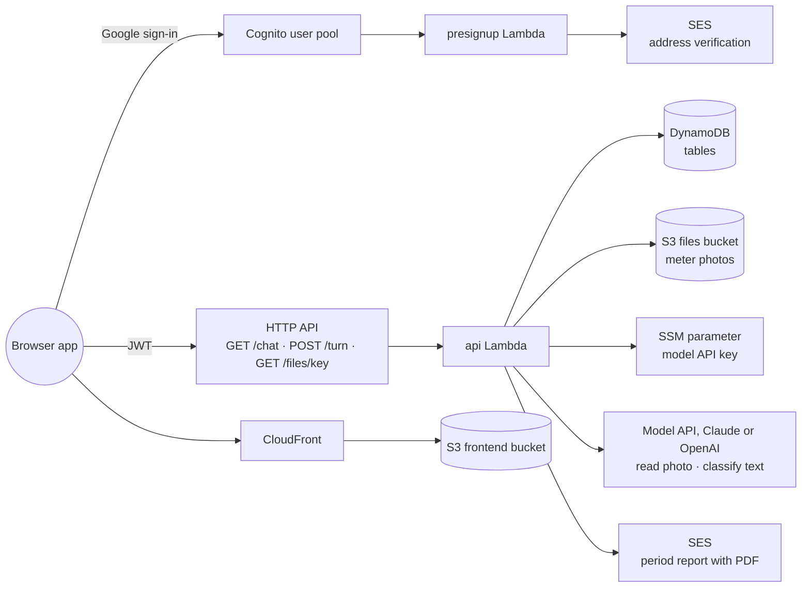

# Architecture

This document details the architecture the [README](../README.md) summarizes: every part the
stacks deploy, what the parts share, where the data lives and how the code is laid out. The
period, reading and charge rules have their own page, [Domain rules](domain-rules.md), and the
shapes the code repeats theirs, [Design patterns](design-patterns.md).

**Contents:** [One body of code, several entry points](#one-body-of-code-several-entry-points) ·
[The entry points](#the-entry-points) · [The conversation engine](#the-conversation-engine) ·
[Configuration both runtimes read](#configuration-both-runtimes-read) · [Storage](#storage) ·
[Codebase structure](#codebase-structure)

Nothing in this app runs between requests. Each request wakes a Python function, which reads and
writes a few DynamoDB tables, may ask the model to read a photo or classify a message, and then
stops. The rationale is [ADR 0001](adr/0001-serverless-on-aws.md).

## One body of code, several entry points

The Python side is a single shared core (`src/common/`) with thin entry points in front of it
(`src/handlers/`): `api.py` behind the HTTP API and `presignup.py` behind the Cognito pool.
`deploy.sh` installs `requirements.txt` for Linux arm64 into `build/lambda`, copies `src/` and
`config/app.json` beside it, and both stacks deploy a zip of that directory, byte-identical for an
unchanged source so such a deploy changes no function. Both functions run Python 3.13 on arm64.

## The entry points

- **Cognito user pool** (`scripts/template-cognito.yaml`, its own stack) — Google is the only
  identity provider, and the hosted sign-in page issues the JWT the API checks; no address can
  register under a password. [Sign-in](sign-in.md) follows the whole sign-in and its Google setup.
- **presignup Lambda** (`src/handlers/presignup.py`) — runs while Cognito creates an account and
  refuses an address that does not fully match `ALLOWED_EMAILS`
  ([ADR 0010](adr/0010-sign-up-by-allowed-list.md)); for an address it admits, it asks SES to
  verify the address so mail can reach it.
- **HTTP API** — checks the Cognito JWT on every route, with CORS for `http://localhost:8000`
  and the CloudFront URL.
- **api Lambda** (`src/handlers/api.py`) — three routes: `GET /chat` loads a day's messages and
  the current card, `POST /turn` takes one user action (a text, a photo, a card choice or a
  retry), and `GET /files/{key+}` hands out a short-lived link to a stored photo. Its 60-second
  limit outlasts the HTTP API's 30, so a photo still being read when the browser's request is
  dropped is saved and arrives on the next load.
  [Requests and their answers](domain-rules.md#requests-and-their-answers) gives every body,
  status and limit.
- **SES** — carries the period report, a PDF of the closed period's figures
  ([Period report](domain-rules.md#period-report)).
- **SSM parameters** `/meters-tracker/llm/<provider>/api-key` — the model provider's API key,
  which the api Lambda reads on its first model call, so replacing the key needs no deploy
  ([ADR 0008](adr/0008-one-stored-key-per-model-provider.md)).
- **DynamoDB tables and the files bucket** — the account's records and its meter photos
  ([Storage](#storage)).
- **Frontend bucket and CloudFront distribution** — host the browser app, a React single-page app
  in Hebrew that renders what the api Lambda returns and decides nothing about the conversation
  ([Design patterns](design-patterns.md#the-browser-app-renders-the-servers-snapshot));
  what a user sees is in [Feature overview](features.md).

## The conversation engine

`src/common/engine.py` takes one action and returns the replies plus a snapshot: the card the user
answers next and the items queued behind it. A photo starts the meter-photo flow; a card choice
goes to the pending item it names; text is classified, and goes to the first item awaiting an
answer, except that a change to a saved record becomes a correction card, planned on a copy of the
account before anything is written. Text with nothing awaiting is classified into a request (close,
vacate, period change, tariffs, delegates), and anything else is answered by a fixed reply that asks
back, never a bare "not understood". Every user action and every reply is appended to the address's
message history.

Each flow is a small state machine stored as a pending item, whose version every card carries, so a
choice answers only the card the user saw and a double answer gets 409
([Every flow is a stored state machine](design-patterns.md#every-flow-is-a-stored-state-machine)).
Code decides every step and renders every reply; the model only reads photos and classifies text,
through the provider `LLM_MODEL` names, and every data write waits behind a confirmation card
([ADR 0005](adr/0005-code-led-conversation.md),
[The model reads, the code decides](design-patterns.md#the-model-reads-the-code-decides)). Billing
periods belong to the apartment, so its water and electricity meters open and close together
([ADR 0003](adr/0003-period-belongs-to-apartment.md)). The flows and the rules they enforce are in
[Domain rules](domain-rules.md).

## Configuration both runtimes read

The two runtimes, the Python Lambda functions and the TypeScript app in the browser, read one file,
`config/app.json`, which holds the tunable values (listed in
[Domain rules](domain-rules.md#values)). The Lambda package carries a copy, found through the
`APP_CONFIG_PATH` environment variable, so an edit needs `deploy.sh`; the frontend bucket serves the
same file at its root as `app.json`, and the Vite dev server serves it from the source file. Each
table's name reaches the code as `<NAME>_TABLE` (`READINGS_TABLE` and so on), the bucket as
`FILES_BUCKET`, the model as `LLM_MODEL`, the key parameter as `LLM_KEY_PARAM`, the api time limit
as `LAMBDA_TIMEOUT_SECONDS`, the mail sender as `SES_SENDER`, the admin address as `ADMIN_EMAIL`.

The browser also reads `config.js`, the stack's endpoints and the admin's address, written by
`scripts/lib/app-config.sh`, which `deploy.sh` runs after every backend deploy and before every
frontend publish. The bundle is therefore the same for every stack.

## Storage

Nine DynamoDB tables, each holding one kind of record under plain keys, with the account (the
owner's lowercase email) or the signed-in address leading the partition key: access, properties,
apartments, meters, periods, readings, tariffs, the pending items and the messages. Meter photos
live in a private S3 files bucket under the account's prefix. No request of the app crosses
accounts or scans a table, and the tables and the bucket survive a stack delete
([ADR 0006](adr/0006-retain-data-on-delete.md)). [Data model](data-model.md) gives each table's
keys and attributes.

## Codebase structure

- `src/handlers/` — the Lambda entry points, `api.py` and `presignup.py`.
- `src/common/` — the shared core: `engine.py` and `flows/` (the conversation, one module per
  card kind: `meter_photo`, `link_meter`, `close_period`, `period_change`, `tariffs`, `correction`,
  `question`, `delegates`), `fields.py` (the table of editable fields), `corrections.py` and
  `account.py` (a correction planned on a copy of the account, and the rows it writes), `periods.py`
  (pure period arithmetic), `store.py` and `paging.py` (DynamoDB), `files.py` (S3), `model.py`
  and `prompts.py` (the model), `report.py` and `notify.py` (the period report and its email),
  `fonts/` (the font the PDF ships with), `access.py`, `texts.py` (every Hebrew string),
  `dates.py`, `log.py`, `ses_identity.py`, `webapi.py`.
- `tests/` — pytest against moto's AWS fakes and a fake model; `engine_kit.py` seeds data and
  fixes the clock for the engine tests, and `test_owner_story.py` walks the owner's whole story.
  `intents.json` holds the recorded messages of a real-model check
  ([Tests](development.md#backend-tests)).
- `frontend/` — the browser app: `src/` holds the API client, sign-in, chat state and
  `components/`, each with its Vitest tests beside it; `public/config.js` is generated and
  gitignored, `config.example.js` documents its keys.
- `scripts/` — the two CloudFormation templates and the operations scripts, described in
  [Development](development.md).
- `config/app.json` — the tunable values.
- `docs/` — this document, the topic documents, the ADRs under `docs/adr/` and the client demo
  under `docs/demo/`.
