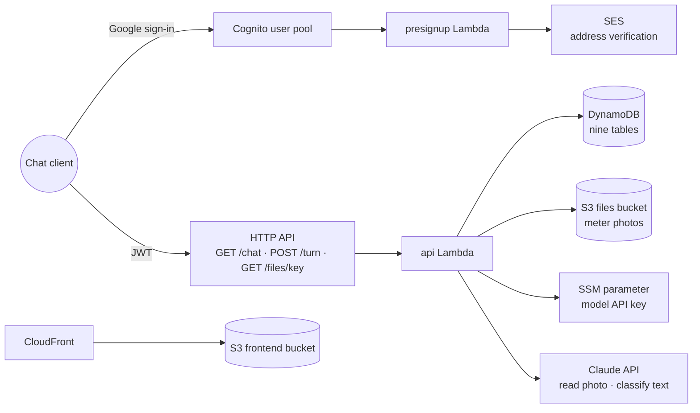

# Architecture

This document details the architecture the [README](../README.md) summarizes: every part the
stacks deploy, what the parts share, where the data lives and how the code is laid out. The
period, reading and charge rules have their own page, [Domain rules](domain-rules.md).

Nothing in this app runs between requests. Each request wakes a Python function, which reads and
writes a few DynamoDB tables, may ask the model to read a photo or classify a message, and then
stops. The rationale is [ADR 0001](adr/0001-serverless-on-aws.md).

## Open items

- OPEN — not yet implemented: the web frontend, a React chat in Hebrew with a file sidebar at
  window widths of 900 px and up. The stack already provisions its S3 bucket and CloudFront
  distribution, and `deploy.sh` writes its runtime configuration, but nothing is published.
- OPEN — not yet implemented: the PDF report of an apartment's period and its email, sent as
  raw MIME through SES under the fixed subject of [ADR 0004](adr/0004-fixed-email-subject.md).
- OPEN — not yet implemented: the daily period-end reminder Lambda and the scheduler that wakes
  it.
- OPEN — not yet implemented: entering tariffs, from a photo of a statement or as typed prices.
  Until then the tariffs table has no writer and replies show no charge.
- OPEN — not yet implemented: the queries over the data (properties, apartments, an apartment's
  status, a meter's history, the tariffs in force, resending a report).
- OPEN — not yet implemented: corrections — editing or deleting a reading, renaming a property
  or apartment, reassigning a meter to another apartment.
- OPEN — not yet implemented: managing delegates from the chat. Sign-in honors delegate rows,
  but nothing writes one yet.
- OPEN — not yet implemented: a period total per meter type across a retired meter and its
  replacement. Consumption is reported per meter; summing the two is planned with the reports.
- OPEN — not yet implemented: a type check (mypy) in `scripts/test.sh`.

## The parts

- **Cognito user pool** (`scripts/template-cognito.yaml`, its own stack) — Google is the only
  identity provider, and the hosted sign-in page issues the JWT the API checks. The pool refuses
  its own sign-up, and its app client allows no password flow, so no one can register an
  address under a password and reach that address's account. Google's `email_verified` is
  mapped into the token, and the api Lambda answers 403 `email_unverified` unless it is
  `"true"`.
- **presignup Lambda** (`src/handlers/presignup.py`) — runs while Cognito creates an account and
  lets every address in. It asks SES to mail the address its verification request unless SES
  already reports it verified or pending, so mail can reach it while the SES account is
  sandboxed. A failure is logged and never refuses the sign-up; an account the operator creates
  directly in the pool passes untouched.
- **HTTP API** — checks the Cognito JWT on every route, with CORS for `http://localhost:8000`
  and the CloudFront URL.
- **api Lambda** (`src/handlers/api.py`) — the three routes, each resolving the JWT's email to
  an account first (see Sign-in under [Cross-cutting mechanisms](#cross-cutting-mechanisms)):
  - `GET /chat` — the signed-in address's latest 200 messages, oldest first, and the snapshot
    (below). The first load of a day adds a greeting when an apartment's period is past its
    end.
  - `POST /turn` — one user action, exactly one of `{"text"}`, `{"image", "media_type",
    "note"?}` with a base64 JPEG or PNG of at most 4 MiB, or `{"choice": {"pending",
    "version", "option"}}` naming the card's pending item, its version and one of its options.
    It returns the replies and the new snapshot. A malformed body is a 400 (`invalid_request`,
    `invalid_image`, `image_too_large`, `unsupported_image_type`), checked before anything is
    stored. A choice whose card the item no longer shows, or whose option that card lacks, is a
    409 `already_handled` carrying the current snapshot; so is the second of two requests
    answering one card at once.
  - `GET /files/{key}` — a presigned GET URL, valid for `file_url_minutes`, for a photo whose
    key starts with the caller's account; any other key is a 403.

  Its time limit is 60 seconds, twice the HTTP API's 30-second limit on the browser's request,
  so a photo the model is still reading when the request is dropped is still saved as a pending
  card that the next `GET /chat` returns. The template defines the limit once and passes it to
  the function as `LAMBDA_TIMEOUT_SECONDS`. Each model attempt gives up after 25 seconds, with
  one retry. A photo still marked as being read once the limit has passed belonged to a killed
  invocation, so the next snapshot turns it into an unreadable card asking for a retake, and the
  next photo replaces it.
- **DynamoDB tables** — nine, described under [Storage](#storage).
- **Files bucket** — the private S3 bucket holding uploaded meter photos.
- **SSM parameter** `/meters-tracker/llm/api-key` — the model provider's API key as a
  SecureString, written by `scripts/set-model-key.sh`. The api Lambda reads it the first time a
  request needs the model, so `GET /chat` never reads it and replacing the key needs no deploy.
- **Frontend bucket and CloudFront distribution** — hosting for the web frontend, see
  [Open items](#open-items).

## The conversation engine

`src/common/engine.py` takes one action and returns the replies plus a snapshot. A photo starts
the meter-photo flow; a card choice goes to the pending item it names; text goes to the oldest
item awaiting an answer; text with nothing awaiting is classified into a close, vacate or
period-change request. Every user action and every reply is appended to the address's message
history.

Each flow (`src/common/flows/`) is a small state machine stored as a **pending item**: `seq`
(a timestamp-ordered key), `kind` (the flow), `status`, `step`, `version` and `data` (the
answers so far). The version grows each time the item shows a card, and every card carries it,
so a choice answers only the card the user saw. Before handling a choice the engine claims the
item with a write that holds only while the version and status are unchanged, so of a
double-click or two devices answering one card, one request proceeds and the other gets 409.
The statuses are `reading` while the model reads the photo, `awaiting` while a card waits for
the user, and `parked` while a close waits for a meter's photo and shows no card. The
**snapshot** is the oldest awaiting item's card plus how many queued items stand behind it; the
client renders it and never orders the queue itself. Code decides every step and renders every
reply from `src/common/texts.py`; the model only reads photos and classifies text, and every
data write waits behind a confirmation card ([ADR 0005](adr/0005-code-led-conversation.md)).
Billing periods belong to the apartment, so its water and electricity meters open and close
together ([ADR 0003](adr/0003-period-belongs-to-apartment.md)). The flows and the rules they
enforce are in [Domain rules](domain-rules.md).

The model client (`src/common/model.py`) calls the model that the deploy setting `LLM_MODEL`
names as `provider:model`, `anthropic:claude-opus-5-5` by default or an OpenAI model, through
that provider's own SDK ([ADR 0007](adr/0007-model-provider-is-a-deploy-setting.md)). Both
implementations ask for an answer shaped to a declared schema (the SDKs call this structured
output) and parse it into a pydantic model: a meter reading (type, serial, candidate values
with their display position, unreadable digits, handwritten label) or one intent from a closed
list — `confirm`, `reject`, `correct_field`, `set_date`, `choose_property`,
`choose_apartment`, `set_period`, `close_period`, `vacate`, `change_period`, `unknown`. The
prompts are in `src/common/prompts.py`. A refusal raises instead of returning a guess.

## Cross-cutting mechanisms

- **One package for both Lambdas.** `deploy.sh` installs `requirements.txt` for Linux arm64
  into `build/lambda`, copies `src/` and `config/app.json` beside it, and both stacks deploy
  from that directory. Both functions run Python 3.13 on arm64.
- **Configuration.** `config/app.json` holds the tunable values (listed in
  [Domain rules](domain-rules.md#values)). The Lambda package carries a copy, found through the
  `APP_CONFIG_PATH` environment variable, so an edit needs `deploy.sh`. Each table's name
  reaches the code as `<NAME>_TABLE` (`READINGS_TABLE` and so on), the bucket as
  `FILES_BUCKET`, the model as `LLM_MODEL`, the key parameter as `LLM_KEY_PARAM`, the api
  time limit as `LAMBDA_TIMEOUT_SECONDS`.
- **Sign-in and accounts.** `src/common/access.py` maps the JWT's email, lowercased, through
  the `access` table: a row names its account; an address with no row becomes the owner of its
  own account, keyed by that address, with a conditional write so two first requests agree.
  Data belongs to the account; the message history and the pending queue belong to the
  signed-in address ([ADR 0002](adr/0002-google-sign-in-and-delegation.md)).
- **Dates.** Every stored and shown date is a calendar date in Asia/Jerusalem
  (`src/common/dates.py`), and the engine takes "today" from an injected clock, so tests fix
  the day.
- **Nothing runs on a clock.** The only time-driven behavior, the daily greeting, is computed
  when the chat loads.
- **Logging.** The api Lambda logs JSON, and the runtime drops its application lines below
  WARN, so its INFO request lines stay hidden until [Development](development.md#logs) raises
  the level.

## Storage

Nine DynamoDB tables, billed per request, each holding one kind of record under a string
partition key `pk` and sort key `sk` (`access` has no sort key). The account id is the owner's
lowercase email. No request of the app crosses accounts or scans a table; the only scan is
`scripts/eval-readings.sh` reading the readings rows that carry failed photos, run by the owner
with their own credentials.

- `access` — pk address, no sk: `email`, `account`, `role` (`owner` or `delegate`).
- `properties` — pk account, sk id: `name`.
- `apartments` — pk account, sk id: `property_id`, `name`, `period_start`, `period_months`.
- `meters` — pk account, sk serial: `apartment_id`, `type` (`water` or `electricity`),
  `display_choice`, `label_hint`, `retired_at`.
- `periods` — pk `account#apartment_id`, sk start date: `months`, `closed_on`,
  `last_reminded_on`.
- `readings` — pk `account#serial`, sk `date#seq`: `value`, `image_key`, `recorded_by`,
  `opens_period`, `closes_period`, `resets`, and, only when non-empty, `failed_photos` (the
  keys of the photos the model failed on) and `model` (the model that failed).
- `tariffs` — pk account, sk effective date: `electricity_per_kwh`, `water_per_m3`.
- `pending` — pk address, sk seq: `kind`, `status`, `step`, `version`, `data`.
- `messages` — pk address, sk timestamp: `role`, `text`, `card`, `image_key`, `pdf_key`.

Photos are stored at `<account>/images/<seq>.jpg` (or `.png`) in the files bucket; the account
prefix is what `GET /files/{key}` checks. `src/common/store.py` converts numbers to and from
DynamoDB's decimals in one place and reads every query across all its pages, except the
message history, which asks for its latest 200 messages in one query. Every read, on
every table, is strongly consistent: a flow reads back within one turn what it has just written,
such as the reading a summary reports or the flags a re-close moved.

The tables and the files bucket survive a stack delete: tables are retained, deletion-protected
and point-in-time recoverable; the bucket is retained and versioned, and a noncurrent version
expires after 30 days. `deploy.sh` refuses to create the app stack while such leftovers exist
([ADR 0006](adr/0006-retain-data-on-delete.md)).

## Codebase structure

- `src/handlers/` — the Lambda entry points, `api.py` and `presignup.py`.
- `src/common/` — the shared core: `engine.py` and `flows/` (the conversation), `periods.py`
  (pure period arithmetic), `store.py` and `paging.py` (DynamoDB), `files.py` (S3), `model.py`
  and `prompts.py` (the model), `access.py`, `texts.py` (every Hebrew string), `dates.py`,
  `log.py`, `ses_identity.py`, `webapi.py`.
- `tests/` — pytest against moto's AWS fakes and a fake model; `engine_kit.py` seeds data and
  fixes the clock for the engine tests.
- `scripts/` — the two CloudFormation templates and the operations scripts, described in
  [Development](development.md).
- `config/app.json` — the tunable values.
- `docs/` — this document, the topic documents, the ADRs under `docs/adr/` and the client demo
  under `docs/demo/`.
