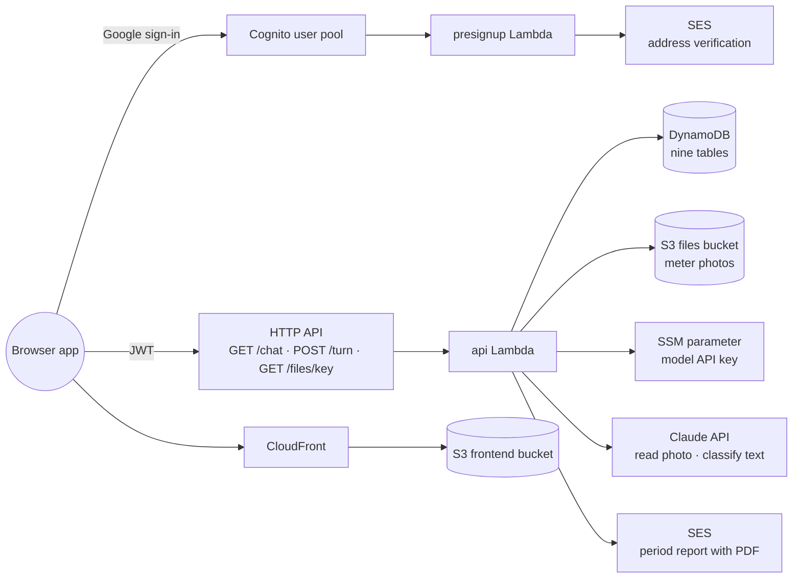

# Architecture

This document details the architecture the [README](../README.md) summarizes: every part the
stacks deploy, what the parts share, where the data lives and how the code is laid out. The
period, reading and charge rules have their own page, [Domain rules](domain-rules.md).

Nothing in this app runs between requests. Each request wakes a Python function, which reads and
writes a few DynamoDB tables, may ask the model to read a photo or classify a message, and then
stops. The rationale is [ADR 0001](adr/0001-serverless-on-aws.md).

## The parts

- **Cognito user pool** (`scripts/template-cognito.yaml`, its own stack) — Google is the only
  identity provider, and the hosted sign-in page issues the JWT the API checks. The pool refuses
  its own sign-up, and its app client allows no password flow, so no one can register an
  address under a password and reach that address's account. Google's `email_verified` is
  mapped into the token, and the api Lambda answers 403 `email_unverified` unless it is
  `"true"`.
- **presignup Lambda** (`src/handlers/presignup.py`) — runs while Cognito creates an account and
  lets every address in. It asks SES to mail the address its verification request unless SES
  already reports it verified or pending, so mail can reach it while the SES account is
  sandboxed. A failure is logged and never refuses the sign-up; an account the operator creates
  directly in the pool passes untouched.
- **HTTP API** — checks the Cognito JWT on every route, with CORS for `http://localhost:8000`
  and the CloudFront URL.
- **api Lambda** (`src/handlers/api.py`) — the three routes, each resolving the JWT's email to
  an account first (see Sign-in under [Cross-cutting mechanisms](#cross-cutting-mechanisms)):
  - `GET /chat` — the signed-in address's messages of one day, at most the latest 200, oldest
    first, and the snapshot (below). The optional `day` query (`YYYY-MM-DD`) names the day, today
    by default; a malformed one is a 400 `invalid_request`. A first load with no message at all
    adds a welcome; the first load of today adds a greeting when an apartment's period is past
    its end.
  - `POST /turn` — one user action, exactly one of `{"text"}`, `{"image", "media_type", "note"?}`
    with a base64 JPEG or PNG of at most 4 MiB, or `{"choice": {"pending", "version", "option"}}`
    naming the card's pending item, its version and one of its options, or `{"retry"}` naming a
    failed message by its stamp. It returns the replies, the new snapshot, and for a photo its
    stored key (`image_key`), so the browser can show its own copy as the stored photo. A malformed
    body is a 400 (`invalid_request`, `invalid_image`, `image_too_large`,
    `unsupported_image_type`), checked before anything is stored. A choice whose
    card the item no longer shows, or whose option that card lacks, is a 409 `already_handled`
    carrying the current snapshot; so is the second of two requests answering one card at once.
    A text or photo is stored before it is handled. When handling fails for any reason, the cause
    is logged as an error, the message is marked `failed` and the answer is a 503 `message_failed`.
    A failed photo leaves no pending item of its own. A retry handles the same message again
    from its stored copy and records `retried_at`; a message not marked failed is a 409
    `already_handled`, so two retries of one failure run once.
  - `GET /files/{key+}` — a presigned GET URL, valid for `file_url_minutes`, for a photo whose
    key starts with the caller's account; any other key is a 403.

  Its time limit is 60 seconds, twice the HTTP API's 30-second limit on the browser's request,
  so a photo the model is still reading when the request is dropped is still saved as a pending
  card that the next `GET /chat` returns. The template defines the limit once and passes it to
  the function as `LAMBDA_TIMEOUT_SECONDS`. Each model attempt gives up after 25 seconds, with
  one retry. A photo still marked as being read once the limit has passed belonged to a killed
  invocation, so the next snapshot turns it into an unreadable card asking for a retake, and the
  next photo replaces it.
- **SES** — the api Lambda sends the period report through it (see Period report under
  [Cross-cutting mechanisms](#cross-cutting-mechanisms)), from the verified `SES_SENDER`. The
  policy allows every identity because the SES sandbox also checks the recipient's address.
- **DynamoDB tables** — nine, described under [Storage](#storage).
- **Files bucket** — the private S3 bucket holding uploaded meter photos.
- **SSM parameters** `/meters-tracker/llm/<provider>/api-key` — one SecureString per model
  provider, written by `scripts/set-model-key.sh`. `scripts/deploy.sh` passes the api Lambda the
  parameter of the provider `LLM_MODEL` names, and its role can read only that one. The Lambda
  reads it the first time a request needs the model, so `GET /chat` never reads it and replacing
  the key needs no deploy. Changing provider leaves the other provider's key stored.
- **Frontend bucket and CloudFront distribution** — host the browser app, published by
  `scripts/sync-frontend.sh`: the Vite bundle, `config.js`, `app.json` and the demo page
  `demo.html`. The app is described under [The browser app](#the-browser-app).

## The browser app

`frontend/` is a React and TypeScript single-page app in Hebrew (`<html lang="he" dir="rtl">`)
that renders what the api Lambda returns and decides nothing about the conversation. Its look
follows the app inside the phone of `docs/demo/demo.html`; every user-visible string is in
`frontend/src/texts.ts`. What a user sees on each surface is in [Features](features.md).

- **Sign-in** (`auth.ts`) — the Cognito hosted page with the authorization-code flow and PKCE,
  Google as the only provider. No secret exists in the browser; the redirect address is the
  site's own origin, and local development runs on port 8000, the callback the Cognito stack
  allows. The ID token authorizes each API call.
- **Chat state** (`useChat.ts`, over TanStack Query) — loads `GET /chat` and keeps the latest
  snapshot it received. A typed turn, a card choice or a photo is a `POST /turn`: the user's message
  is shown at once, the server's replies are appended and its snapshot replaces the shown one, then
  a refetch of `GET /chat` replaces the local entries with the server's history. A sent photo's
  stored key, from the reply, takes the page's own copy as its link, so it shows with no download. A
  stale choice (409) only replaces the snapshot. A turn lost to the network or a gateway timeout
  only refetches, since the server may have handled it. A 503 `message_failed` only refetches too,
  which brings the message with its failed mark and retry button; a text or photo whose request
  never reached the server stays in the page with a resend while the page is open. Any other
  failure shows a notice and refetches. Several photos can be in flight together. While the
  snapshot shows no card, counts waiting items and no turn is in flight, `GET /chat` is polled
  every 5 seconds, so a card saved after the gateway gave up still arrives. With a card shown the
  waiting count includes cards queued behind it, so polling stops.
- **Cards** (`CardView.tsx`) — the buttons come from the snapshot card's options, a choice
  posts the card's `pending`, `version` and the option, and `foldChoices.ts` shows a recorded
  choice in place on the card its `choice` names instead of as a bubble of its own; typed text
  never folds.
- **Photos** (`images.ts`) — the camera button takes a photo or picks existing ones; each is
  scaled to 1600 px on its longer edge and re-encoded as JPEG, which keeps it under the API's
  4 MiB limit. A thumbnail or the full-screen viewer fetches a link from `GET /files/{key+}`.
- **Layout** — a header with the signed-in user and a sign-out menu; from the width in
  `sidebar_min_width_px` of `config/app.json` (900), a panel of the day's activity, which
  `activity.ts` derives from the loaded messages, so it needs no request of its own and follows
  every refetch, and from the snapshot's `tariffs_missing`, true while a request for tariffs is
  open, even behind another card. Below that width the same lists sit behind a strip under the
  header (`DayStrip.tsx`), present only while a list has lines or tariffs are missing. A tapped
  line focuses its message in the thread. The border
  between the panel and the chat sets the panel's width (`PanelResizer.tsx`), kept in the browser's
  local storage, and the stylesheet stops the page at a maximum width. One full-screen photo
  viewer, owned by `App.tsx`, serves the thread.
- **Runtime configuration** — `config.js` carries the stack's endpoints and is generated by
  `deploy.sh`; `app.json` is `config/app.json`, which the bucket serves at its root and the Vite
  dev server serves from the file.

## The conversation engine

`src/common/engine.py` takes one action and returns the replies plus a snapshot. A photo starts
the meter-photo flow; a card choice goes to the pending item it names; text goes to the oldest
item awaiting an answer; text with nothing awaiting is classified into a close, vacate,
period-change or tariffs request. Every user action and every reply is appended to the
address's message history.

Each flow (`src/common/flows/`) is a small state machine stored as a **pending item**: `seq` (a
timestamp-ordered key), `kind` (the flow), `status`, `step`, `version` and `data` (the answers so
far). The version grows each time the item shows a card, and every card carries it, so a choice
answers only the card the user saw. Before handling a choice the engine claims the item with a write
that holds only while the version and status are unchanged, so of a double-click or two devices
answering one card, one request proceeds and the other gets 409. The statuses are `reading` while
the model reads the photo, `awaiting` while a card waits for the user, `parked` while a close waits
for a meter's photo and shows no card, and `standby` while a request for tariffs waits without
blocking the queue: its card shows only when no card awaits, and typed text with nothing awaiting
reaches it only when it is prices, a cancel or a question; any other text is classified as a request
as usual. The **snapshot** is the oldest awaiting item's card, else the oldest standby item's, plus
how many queued items stand behind it; the client renders it and never orders the queue itself. Code
decides every step and renders every reply from `src/common/texts.py`; the model only reads photos
and classifies text, and every data write waits behind a confirmation card ([ADR
0005](adr/0005-code-led-conversation.md)). Billing periods belong to the apartment, so its water and
electricity meters open and close together ([ADR 0003](adr/0003-period-belongs-to-apartment.md)).
The flows and the rules they enforce are in [Domain rules](domain-rules.md).

The model client (`src/common/model.py`) calls the model that the deploy setting `LLM_MODEL` names
as `provider:model`, `anthropic:claude-opus-5-5` by default or an OpenAI model, through that
provider's own SDK ([ADR 0008](adr/0008-one-stored-key-per-model-provider.md)). Both
implementations ask for an answer shaped to a declared schema (the SDKs call this structured output)
and parse it into a pydantic model: a meter reading (type, serial, candidate values with their
display position, unreadable digits, handwritten label), a previous statement's tariffs (whether the
photo is a statement, the electricity and water prices, whether they include VAT), or one intent
from a closed list —
`confirm`, `reject`, `correct_field`, `set_date`, `choose_property`, `choose_apartment`,
`choose_option`, `set_period`, `close_period`, `vacate`, `change_period`, `set_tariffs`, `explain`,
`unknown`. A photo is read as a statement only when its meter read finds neither a meter type nor a
serial. Each classification is sent with today's date and the pending card's text with its button
labels; a request no card takes is sent with the account's apartment names instead, after any
standby card, so the model names the apartment exactly as stored. The prompts are in
`src/common/prompts.py`. A refusal raises instead of returning a guess.

## Cross-cutting mechanisms

- **One package for both Lambdas.** `deploy.sh` installs `requirements.txt` for Linux arm64
  into `build/lambda`, copies `src/` and `config/app.json` beside it, and both stacks deploy
  a zip of that directory, byte-identical for an unchanged source so such a deploy changes no
  function. Both functions run Python 3.13 on arm64.
- **Configuration.** `config/app.json` holds the tunable values (listed in
  [Domain rules](domain-rules.md#values)). The Lambda package carries a copy, found through the
  `APP_CONFIG_PATH` environment variable, so an edit needs `deploy.sh`. Each table's name
  reaches the code as `<NAME>_TABLE` (`READINGS_TABLE` and so on), the bucket as
  `FILES_BUCKET`, the model as `LLM_MODEL`, the key parameter as `LLM_KEY_PARAM`, the api
  time limit as `LAMBDA_TIMEOUT_SECONDS`, the mail sender as `SES_SENDER`.
- **Sign-in and accounts.** `src/common/access.py` maps the JWT's email, lowercased, through
  the `access` table: a row names its account; an address with no row becomes the owner of its
  own account, keyed by that address, with a conditional write so two first requests agree.
  Data belongs to the account; the message history and the pending queue belong to the
  signed-in address ([ADR 0002](adr/0002-google-sign-in-and-delegation.md)).
- **Period report.** A flow marks a period for a report during a turn, and the engine sends it
  once the turn's replies are stored, so a reading that also closes its period sends one report,
  with the final figures. `src/common/report.py` takes the figures from `period_figures`, the code
  the chat's summary uses, and draws a one-page PDF with fpdf2. It shapes the Hebrew with HarfBuzz
  and a DejaVu Sans font shipped under `src/common/fonts/`, and is imported only when a report is
  drawn. `src/common/notify.py` sends it as raw MIME, base64 encoded, under the fixed subject of
  [ADR 0004](adr/0004-fixed-email-subject.md). A failed report is logged and never fails the turn,
  since the reading is already saved.
- **Dates.** Every stored and shown date is a calendar date in Asia/Jerusalem
  (`src/common/dates.py`), and the engine takes "today" from an injected clock, so tests fix
  the day.
- **Nothing runs on a clock.** The only time-driven behavior, the daily greeting, is computed
  when the chat loads.
- **Logging.** The api Lambda logs JSON, and the runtime drops its application lines below
  WARN, so its INFO request lines stay hidden until [Development](development.md#logs) raises
  the level.

## Storage

Nine DynamoDB tables, billed per request, each holding one kind of record under a string
partition key `pk` and sort key `sk` (`access` has no sort key). The account id is the owner's
lowercase email. No request of the app crosses accounts or scans a table. Scripts run by the
owner with their own credentials scan: `scripts/reset-account.sh` finds every row one account
owns in each table, and a real-model check reads the readings that carry failed photos
([Tests](development.md#tests)).

- `access` — pk address, no sk: `email`, `account`, `role` (`owner` or `delegate`).
- `properties` — pk account, sk id: `name`.
- `apartments` — pk account, sk id: `property_id`, `name`, `period_start`, `period_months`.
- `meters` — pk account, sk serial: `apartment_id`, `type` (`water` or `electricity`),
  `display_choice`, `label_hint`, `retired_at`.
- `periods` — pk `account#apartment_id`, sk start date: `months`, `closed_on`,
  `last_reminded_on`.
- `readings` — pk `account#serial`, sk `date#seq`: `value`, `image_key`, `recorded_by`,
  `opens_period`, `closes_period`, `resets`, and, only when non-empty, `failed_photos` (the
  keys of the photos the model failed on) and `model` (the model that failed).
- `tariffs` — pk account, sk effective date: `electricity_per_kwh`, `water_per_m3` (either
  null when that type is unpriced), `source_image_key` (the statement photo, or null when
  typed).
- `pending` — pk address, sk seq: `kind`, `status`, `step`, `version`, `data`.
- `messages` — pk address, sk timestamp: `role`, `text`, `card`, `image_key`, `pdf_key`,
  `choice`. A choice is recorded as a user message whose `text` is the option's label and whose
  `choice` is `{pending, version}` of the card it answered; on any other message it is null.
  A text or photo whose handling failed also holds `failed`, until a retry clears it, and a
  retried one holds `retried_at`, the stamp of its latest retry. A meter photo's message holds
  `reading` once the model has answered: `state` (`awaiting`, `saved` or `dropped`), `meter_type`,
  `apartment` and `property`, updated each time the photo's flow shows a card or ends.

Photos are stored at `<account>/images/<seq>.jpg` (or `.png`) in the files bucket; the account
prefix is what `GET /files/{key+}` checks. `src/common/store.py` converts numbers to and from
DynamoDB's decimals in one place and reads every query across all its pages, except the
message history, which asks for its latest 200 messages in one query. Every read, on
every table, is strongly consistent: a flow reads back within one turn what it has just written,
such as the reading a summary reports or the flags a re-close moved.

The tables and the files bucket survive a stack delete: tables are retained, deletion-protected
and point-in-time recoverable; the bucket is retained and versioned, and a noncurrent version
expires after 30 days. `deploy.sh` refuses to create the app stack while such leftovers exist
([ADR 0006](adr/0006-retain-data-on-delete.md)).

## Codebase structure

- `src/handlers/` — the Lambda entry points, `api.py` and `presignup.py`.
- `src/common/` — the shared core: `engine.py` and `flows/` (the conversation), `periods.py`
  (pure period arithmetic), `store.py` and `paging.py` (DynamoDB), `files.py` (S3), `model.py`
  and `prompts.py` (the model), `report.py` and `notify.py` (the period report and its email),
  `fonts/` (the font the PDF ships with), `access.py`, `texts.py` (every Hebrew string),
  `dates.py`, `log.py`, `ses_identity.py`, `webapi.py`.
- `tests/` — pytest against moto's AWS fakes and a fake model; `engine_kit.py` seeds data and
  fixes the clock for the engine tests, and `test_owner_story.py` walks the owner's whole story.
  `intents.json` holds the recorded messages of a real-model check ([Tests](development.md#tests)).
- `frontend/` — the browser app: `src/` holds the API client, sign-in, chat state and
  `components/`, each with its Vitest tests beside it; `public/config.js` is generated and
  gitignored, `config.example.js` documents its keys.
- `scripts/` — the two CloudFormation templates and the operations scripts, described in
  [Development](development.md).
- `config/app.json` — the tunable values.
- `docs/` — this document, the topic documents, the ADRs under `docs/adr/` and the client demo
  under `docs/demo/`.
